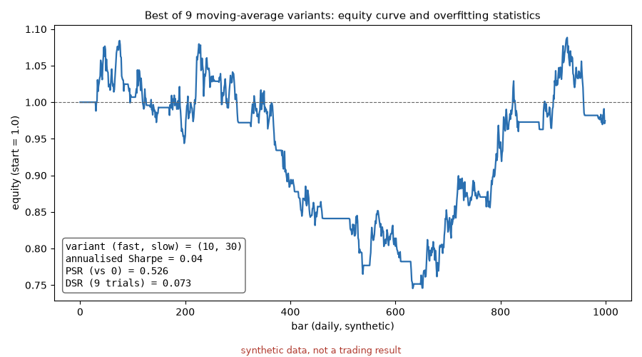

# oss-backtest-kit

[](https://github.com/ww7411/oss-backtest-kit/actions/workflows/ci.yml)
[](https://pypi.org/project/oss-backtest-kit/)
[](https://pypi.org/project/oss-backtest-kit/)
[](https://github.com/ww7411/oss-backtest-kit/blob/main/LICENSE)
[](https://colab.research.google.com/github/ww7411/oss-backtest-kit/blob/main/examples/quickstart.ipynb)

**Run an overfitting checkup on a backtest you already have (freqtrade result or CSV, one command).** Is your backtest real, or did you just try enough ideas until one looked good? A small, honest toolkit for crypto futures research: verified public data, a no-look-ahead backtest engine, and the statistics that tell you how much of your Sharpe ratio is luck.

## Try it in 30 seconds

Check a backtest you already have (a freqtrade result `.zip` / `.json`, a CSV of returns or equity, or a folder of results; nothing is downloaded and no account is needed):

```
pip install oss-backtest-kit
python -m oss_backtest_kit.checkup <your result file or folder> --trials N
```

No result at hand? The statistics also work on any array of returns:

```
pip install oss-backtest-kit
python -c "import numpy as np; from oss_backtest_kit import stats; r = np.random.default_rng(0).normal(0.0005, 0.01, 500); print('PSR', stats.psr(r)); print('DSR', stats.dsr(r, n_trials=20, trial_sharpes=[0.01, 0.03, 0.02])[0])"
```

The second number is lower than the first: the Deflated Sharpe Ratio charges you for the 20 variants you tried.



*Synthetic data, not a trading result. The best of 9 moving-average variants has an average return just above zero (Sharpe ratio slightly positive, PSR 0.53), but the equity curve still ends a little below its start (0.97), because volatility drags down compounded growth; after charging for the 9 tries the DSR is 0.07, so there is no evidence of skill. Reproduce it with `examples/equity_psr_dsr.py`.*

## Highlights

- **Overfitting checks built in.** Deflated Sharpe Ratio, Probabilistic Sharpe Ratio and Probability of Backtest Overfitting (CSCV) adjust your result for how many variants you tried, so a lucky curve is easier to spot before it costs money.
- **Data you can trust.** Every Binance public archive file is checked against its published SHA-256 before it is saved; a manifest records what you have; gaps and duplicate bars are reported, not silently filled.
- **No look-ahead by design.** Your strategy is called at a bar's close and sees only bars up to that point; orders fill at the next bar's open with slippage and fees.
- **Costs that bite.** Perpetual-futures funding is included, and a `stressed` cost level lets you check whether an edge survives worse fills.
- **Small and readable.** Pure Python with only numpy and scipy; offline tests only; no account, API key or paid data needed.
- **MIT licensed** code (the market data has its own terms; see below).

## Who it is for

Individual researchers and students who write their own strategies in Python and want a quick, sober second opinion on a backtest. It is not a trading bot, does not place orders and does not connect to any exchange account.

## What is inside

A small research toolkit for crypto strategies, in four parts:

1. **Multiple-testing statistics** (`oss_backtest_kit.stats`): Sharpe, Probabilistic Sharpe Ratio (PSR), Deflated Sharpe Ratio (DSR), Probability of Backtest Overfitting (CSCV), effective number of trials, circular block bootstrap, Wilson intervals.
2. **Public data download and verification** (`oss_backtest_kit.data`): fetches Binance public archive files, verifies each against its published SHA-256 checksum, records a manifest, and checks bar continuity. A REST helper exports the most recent days as separate CSV files (not loaded by the engine).
3. **A simple, config-driven backtest engine** (`oss_backtest_kit.engine`) for a portfolio of perpetual futures, with funding and a two-level cost model.
4. **An overfitting checkup** (`oss_backtest_kit.checkup`, with readers in `oss_backtest_kit.loaders`): reads backtest results from other tools (freqtrade result files, CSV, arrays) and writes a Markdown or HTML report.

## DISCLAIMER

This project is for **research and education only**. It is **not investment advice**. It comes with **no warranty** of any kind; you use it **at your own risk**. **Backtest results are not live results**: past or simulated performance says little about future outcomes, and you can lose money trading.

## Status

Early release (version 0.2.0). The project is maintained: bug reports and pull requests are welcome. The API may still change before 1.0; see [CHANGELOG.md](https://github.com/ww7411/oss-backtest-kit/blob/main/CHANGELOG.md).

## Requirements and install

- Python 3.9 or newer, with numpy and scipy (installed automatically below).
- Internet access only if you download data; everything else, tests included, runs offline.
- Some Python knowledge: you write your strategy as a small Python function.

```
git clone https://github.com/ww7411/oss-backtest-kit.git
cd oss-backtest-kit
pip install -e .
```

Tests use pytest (install the test extra first: `pip install -e ".[test]"`). The stats, engine and data test files can also be run directly with `python3`.

## Quick start

Download public data (nothing is downloaded unless you run this; the output folder is yours to choose):

```
python -m oss_backtest_kit.data archive --kinds klines,fundingRate --symbols BTCUSDT \
    --interval 1d --from 2024-01 --to 2024-06 --out ./market_data
python -m oss_backtest_kit.data check --out ./market_data \
    --kind klines --symbol BTCUSDT --interval 1d
```

Kinds: `klines` (needs `--interval`), `markPriceKlines`, `indexPriceKlines`, `premiumIndexKlines`, `fundingRate`, `metrics`. Files that fail the checksum are neither saved nor recorded; existing files are never overwritten. Recent bars not yet in the archive can be exported with the `rest` subcommand; it writes standalone CSV files under `<out>/rest/` for inspection or your own merging. They are not added to the manifest and `load_market_data` does not read them, so a backtest ends at the last archive file.

Run the moving-average crossover example (synthetic data, nothing downloaded):

```
python3 examples/ma_crossover.py
```

Draw the effect chart above (needs matplotlib, an optional extra that is not a runtime dependency):

```
pip install -e ".[examples]"
python3 examples/equity_psr_dsr.py
```

Or open the [quick start notebook in Colab](https://colab.research.google.com/github/ww7411/oss-backtest-kit/blob/main/examples/quickstart.ipynb) (synthetic data, no download).

Use the statistics:

```python
import numpy as np
from oss_backtest_kit import stats

returns = np.random.default_rng(0).normal(0.0005, 0.01, 500)
print(stats.psr(returns))                                # P(true Sharpe > 0)
value, benchmark, var = stats.dsr(returns, n_trials=20,  # penalise 20 tries
                                  trial_sharpes=[0.01, 0.03, 0.02])
print(stats.wilson(7, 50))                               # 95% interval for 7/50
```

Run a backtest on your own downloaded data:

```python
from oss_backtest_kit.engine import EngineConfig, load_market_data, run_backtest

data = load_market_data("./market_data", ["BTCUSDT"], interval="1d")
cfg = EngineConfig(symbols=["BTCUSDT"], max_leverage=1.0, rebalance_threshold=0.02)

def strategy(t, history):          # called at the close of bar t, sees bars 0..t only
    return {"BTCUSDT": 1.0}        # sum(|weights|) must not exceed max_leverage

result = run_backtest(data, strategy, cfg, cost_level="stressed")
print(result.summary())            # result.returns feeds stats.psr / stats.dsr
```

## Checkup: is this backtest overfitted?

The checkup reads the result of a backtest you already ran (in this kit or in another tool) and answers one question: how much of the result could be luck from trying many versions. It needs only numpy and scipy, runs offline and does not install or import the other tool.

Try it on synthetic data first (one overfitted group, one robust group; nothing is downloaded):

```
python3 examples/checkup_demo.py
```

On your own results, from the command line:

```
python -m oss_backtest_kit.checkup <result file or folder> --trials N [--report out.md] [--html out.html]
```

If the reader asks for more information, give it with a switch: `--strategy NAME` (a freqtrade file that holds several strategies), `--starting-balance X` (a freqtrade file that does not state the starting balance), and for CSV files `--time-col NAME`, `--value-col NAME` and `--kind returns|equity`. A folder reads every strategy of every file in it.

- The input is a freqtrade backtest result (`.json` or `.zip`; supported from the format documentation and test fixtures for freqtrade 2021.1 to 2026.10; verified on real results of one version only, freqtrade 2026.10: one spot run and one futures run with long and short trades (`tests/data/real_freqtrade_2026_10/`, `tests/data/real_freqtrade_2026_10_futures/`); see `docs/SPEC_B.md` for what was and was not checked), a CSV with a date column and a return column (or an equity curve), or a folder holding one such file per parameter set. In Python you can also pass a NumPy array or a pandas Series (pandas is optional and never imported by the kit).
- `--trials N` is how many versions you tried in total, **including the ones you did not save**. If you leave it out, the number of result files is used, and the report says so. A too-small N makes the Deflated Sharpe Ratio too kind. With one result and no `--trials`, nothing can be deflated, so the DSR line says it cannot be judged and the overall verdict is at most CAUTION; pass `--trials 1` only if that really was the only version you tried. With several results and no `--trials`, the number of results is only a lower bound, so the overall verdict is also at most CAUTION.
- Returns that depend on each other from day to day (long runs of similar values) carry less evidence than their row count suggests: the report estimates how many rows make one independent observation (`Serial dependence`) and judges PSR, DSR, the sample-size rule and the bootstrap on that effective count.
- With two or more results the report also gives PBO (Probability of Backtest Overfitting), and the Sharpe, PSR, DSR and bootstrap lines describe the result with the highest Sharpe (or the one you name with `--select`).
- Exit status 0 means the checkup ran (whatever the verdict); 2 means the input could not be checked, and the message on stderr says why.

How to read the report. Each line has a verdict in words: PASS, CAUTION, FAIL (or INFO for facts such as the drawdown) and one sentence. The thresholds are printed at the bottom of every report. Read the DSR and PBO lines first when you tried several versions: PSR and the bootstrap interval are not corrected for picking the best one. Fewer than 180 observations can never pass, and fewer than 30 are refused. The report also lists notes, for example when the data is not daily or very sparse.

In Python:

```python
from oss_backtest_kit.checkup import checkup

report = checkup("./results_folder", n_trials=25)
print(report.overall)            # "pass", "caution" or "fail": the worst line
print(report.to_markdown())      # or report.to_html() for one self-contained file
```

**The checkup only lowers the risk of shipping an overfitted backtest. It cannot show that a strategy will make money**: a result can pass every line and still lose money live, and the thresholds are conventions, not guarantees. See the disclaimer below.

## Modules

| Module | Purpose |
| --- | --- |
| `stats` | PSR, DSR, PBO (CSCV), effective trials, block bootstrap, Wilson interval |
| `data.archive` | Archive download with checksum verification, manifest, exclusive-create writes |
| `data.rest_tail` | Recent closed bars and funding from public REST endpoints |
| `data.check` | Manifest SHA check, gap and duplicate detection |
| `engine` | Config, market data loader, backtest loop, result summary |
| `loaders` | Read backtest results (freqtrade result files, CSV, arrays, a folder of results) as daily returns |
| `checkup` | Overfitting checkup and its command line; `report` writes the Markdown / HTML report |

The data client allows a single host per task, uses https only, ignores environment proxy settings, refuses redirects, bounds response size and time, and stops when free disk space is low.

## Tests

```
pip install -e ".[test]"
python3 -m pytest
```

All tests run offline with synthetic data and fake network responses.

## Known limitations

- Fills are modelled from OHLC bars (decision at a bar close, fill at the next open with slippage and a proportional fee). Real fills depend on order books, latency and size.
- Funding is modelled as position x price x rate at each funding time, using the open price of the bar that contains the event; margin, liquidation and exchange rules are not modelled beyond stopping at zero equity (limited liability: positions are closed at that bar's close and any loss beyond zero is reported as `ruin_shortfall`, so `sum(pnl_by_symbol) + ruin_shortfall` equals the change in equity).
- Survivorship bias: the symbols you choose are the ones that exist today; delisted symbols are not included unless you add them.
- Cost defaults (`base` and `stressed`) are placeholders, not estimates for any venue. Set your own numbers.
- Statistics assume the return series is a fair sample; PSR/DSR/PBO reduce, but do not remove, the risk of overfitting.

## Data terms

This kit ships **code only and never any market data** (no candles, no ticks). One exception to note: `tests/data/real_freqtrade_2026_10/` and `tests/data/real_freqtrade_2026_10_futures/` hold the result files of two small freqtrade backtests (one spot, one futures) used as tests (trade records of a demonstration strategy, computed from public exchange candles, plus a market-change and a wallet series derived from them; not the raw candles). Delete those folders if you redistribute the package and are unsure about them. It downloads from two different sources, which have **different terms**. Nothing here is legal advice; read the current terms yourself before downloading, using or sharing any data.

**1. Archive files from `data.binance.vision`** (`archive` subcommand). These are described in the `binance/binance-public-data` repository (https://github.com/binance/binance-public-data), whose `TERMS_AND_CONDITIONS.md` states a CC BY-NC-SA 4.0 licence (https://creativecommons.org/licenses/by-nc-sa/4.0/). As we read that licence, it means:

- **Attribution**: if you share the data or anything derived from it (cleaned files, aggregated tables, published charts of the data), credit the source, link the licence, and say whether you changed it.
- **NonCommercial**: no commercial use of the data.
- **ShareAlike**: data you derive from it and share must be shared under the same licence.

**2. Recent data from the REST API at `fapi.binance.com`** (`rest` subcommand). This is **not** covered by the archive licence above. It falls under the exchange's own API and website terms of use, which this project has **not** reviewed; we make no statement about what they allow. Check them before using or sharing REST data.

You alone are responsible for complying with the terms of each source and with the exchange's rules.

## License

MIT; see [LICENSE](https://github.com/ww7411/oss-backtest-kit/blob/main/LICENSE). The licence covers this code only, not any market data you download with it (see the data terms above).
